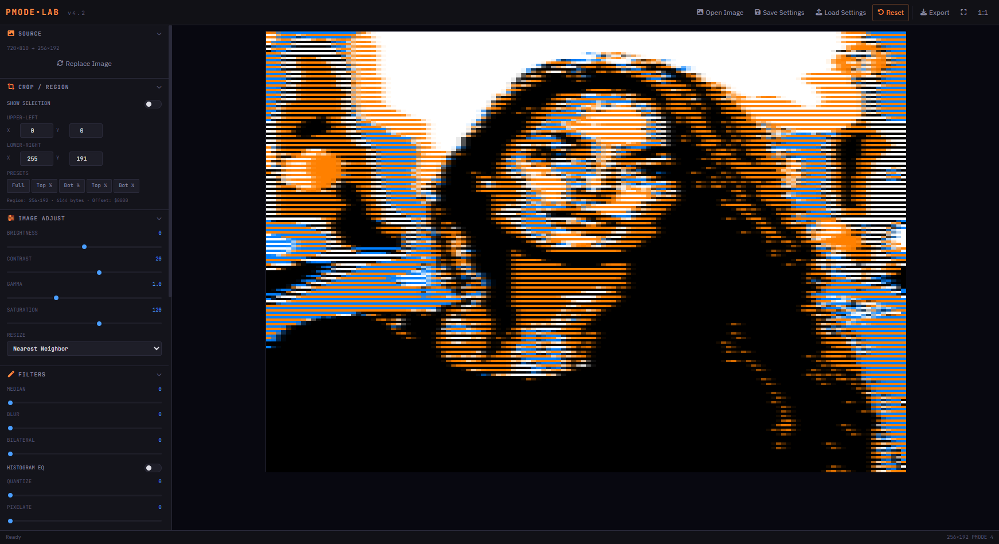

# PMODE Lab v4.2

PMODE Lab is a browser-based graphics conversion tool designed for the TRS-80 Color Computer (CoCo). It converts modern images into authentic PMODE 4 format, with a strong focus on artifact color rendering.

The tool provides advanced image processing, dithering algorithms, NTSC artifact simulation, and export options suitable for retro development workflows.

---

## Features

### Core Capabilities
- Convert images to CoCo PMODE 4
- Accurate NTSC artifact color simulation
- Real-time preview with multiple display modes
- 256×192 resolution output (CoCo standard)

### Image Processing
- Brightness, contrast, gamma, and saturation controls
- Resize algorithms: nearest, bilinear, lanczos
- Advanced filters:
  - Median filter
  - Blur / averaging
  - Bilateral smoothing
  - Histogram equalization
  - Quantization
  - Pixelation
  - NTSC blur simulation

### Dithering Options
- Color pattern matching (standard and enhanced)
- Floyd–Steinberg error diffusion
- Atkinson dithering
- Bayer 4×4 ordered dithering
- Noise dithering
- Nearest color (no dithering)

### Artifact Simulation
- Toggle artifact colors on/off
- Multiple color sets (Green / Buff modes)
- Phase control
- Adjustable NTSC bleed simulation

### Editing Tools
- Crop and region selection
- Preset crop regions (top, bottom, thirds)
- Zoom and aspect ratio controls (true pixel vs 4:3 TV)

### Preview Modes
- Source image
- Converted output
- Composite simulation
- Split view (before/after)

### Export Options
- PNG (scaled output)
- Raw binary
- RLE compressed binary
- C array format
- Assembly (FCB) format

### Batch Processing
- Process entire folders of images
- Automated export pipeline

### Project Support
- Save and load settings as JSON
- Reproducible conversion workflows

---

## Usage

1. Open the app in your browser.
2. Click **Open Image** to load a source file.
3. Adjust image settings, filters, and dithering options.
4. Preview results in real time.
5. Export in your desired format.

---

## Output Formats

| Format | Use Case |
|------|--------|
| PNG | Visual preview / sharing |
| RAW | Direct binary for CoCo |
| RLE | Compressed storage |
| C Array | Embedding in C programs |
| ASM (FCB) | Assembly development |

---

## Technical Details

- Resolution: 256×192
- Pixel encoding: 1-bit pairs (artifact color generation)
- Supports NTSC artifact simulation via phase and bleed modeling
- Implements multiple dithering kernels and error diffusion methods

---

## Requirements

- Modern web browser (Chrome recommended)
- No installation required

---

## Roadmap Ideas

- Direct .BIN loader for emulator testing
- Pattern editor
- True composite signal simulation

---

## License

Add your preferred license here (MIT recommended for open source projects).

---

## Author

Carlos Camacho
